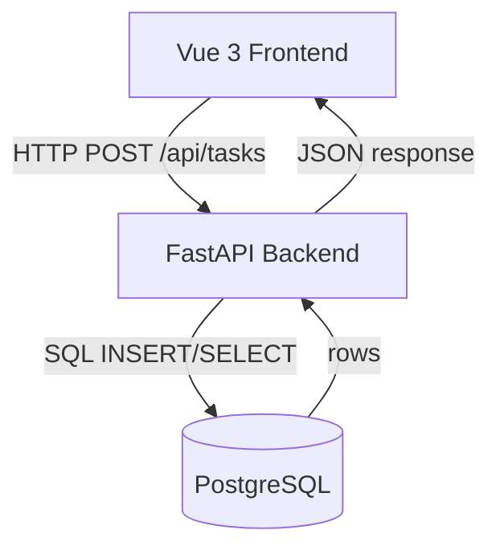

# TaskFlow Component Diagram — Model Answer

This diagram shows the three tiers of TaskFlow and how they connect, using
the real technology choices from `TECHNOLOGY-STACK_MODEL_ANSWER.md`. The
labeled arrow between frontend and backend shows the task-creation flow
(`POST /api/tasks`), the same anticipatory endpoint documented in
`docs/API.md`, it isn't built yet, but designing the shape now is what makes
implementing it later straightforward.

## Connections Explained

- **Vue 3 Frontend -> FastAPI Backend:** the browser sends REST requests
  (HTTP) to create, read, update, and delete tasks.
- **FastAPI Backend -> PostgreSQL:** the API runs SQL queries to persist and
  retrieve data.
- **PostgreSQL -> FastAPI Backend:** the database returns query results as
  rows.
- **FastAPI Backend -> Vue 3 Frontend:** the API returns JSON, and the
  frontend updates the UI.

## Try It Yourself

The diagram above only shows the task-creation path. `GET /health` is a real
endpoint that exists in the backend today (`backend/app/main.py`), used by
Docker and Kubernetes health checks. As a light, concrete extension, add one
more node and connection to your copy of this diagram showing an
orchestrator (Docker or Kubernetes) polling `GET /health` on the backend.
That's a genuine platform-engineering concern, not a cosmetic addition, and
it's small enough to add using the exact same Mermaid syntax already used
above (one more `-->` line with a `|label|`).
